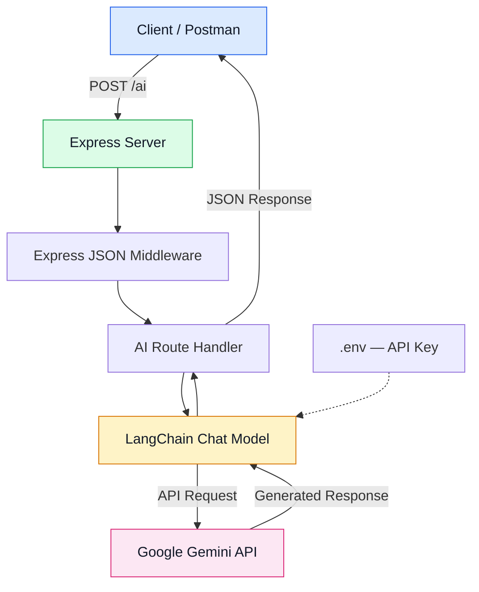
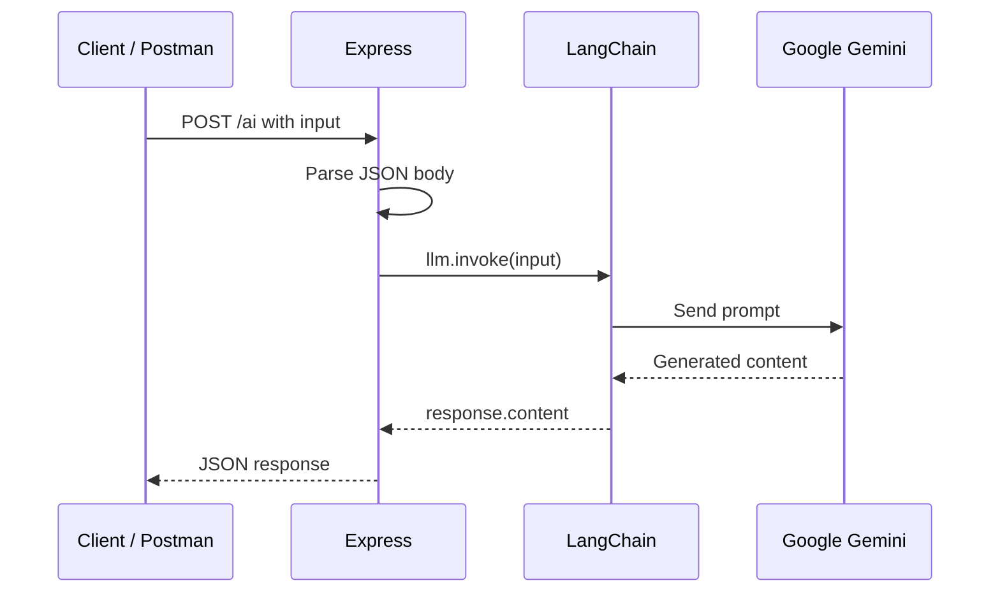

# LLM
Learning to implement LLM with LangChain framework .

# ⚡ LLM Backend — LangChain + Google Gemini

A simple LLM backend built with **Node.js, Express.js, LangChain, and Google Gemini**. This project demonstrates how to send prompts to an LLM and return AI-generated responses through a REST API.

## 🏗️ Architecture Overview



## 🛠️ Tech Stack

- **Node.js** — JavaScript runtime
- **Express.js** — HTTP server and REST API
- **LangChain** — LLM integration and orchestration
- **Google Gemini** — Language model provider
- **Google GenAI SDK** — Direct Google AI API integration
- **dotenv** — Environment variable management
- **Postman** — API testing

## 📁 Project Structure

```text
LLM/
├── index.js
├── .env
├── .gitignore
├── package.json
└── README.md
```

## 📦 Installation

Install the dependencies:

```bash
npm init -y
npm install express dotenv @google/genai @langchain/google-genai
npm install --save-dev nodemon
```

Configure ES modules and scripts in `package.json`:

```json
{
  "type": "module",
  "scripts": {
    "dev": "nodemon index.js",
    "start": "node index.js"
  }
}
```

## 🔐 Environment Configuration

Create a `.env` file in the project root:

```env
PORT=5001
GOOGLE_API_KEY=your_google_api_key
```

Add the following to `.gitignore`:

```gitignore
node_modules/
.env
```

Never commit your API key to GitHub.

## 🧠 LLM Integration

The application uses two Google AI integrations:

### 1. Google GenAI SDK

```javascript
import { GoogleGenAI } from "@google/genai";

const ai = new GoogleGenAI({
  apiKey: process.env.GOOGLE_API_KEY,
});
```

This initializes the direct Google GenAI SDK. In the current implementation, the `ai` instance is initialized but is not used to generate responses.

### 2. LangChain Google GenAI

```javascript
import { ChatGoogleGenerativeAI } from "@langchain/google-genai";

const llm = new ChatGoogleGenerativeAI({
  model: "YOUR_SUPPORTED_MODEL_ID",
  apiKey: process.env.GOOGLE_API_KEY,
});
```

LangChain provides the `invoke()` method to send input to the configured chat model.

Choose a model ID currently supported by your API key and the installed integration. Do not assume that `gemini-3.5-flash` is a valid model ID without verifying its availability.

## 🔄 Request Lifecycle



## 🚀 API Endpoints

### GET /

Checks whether the server is running.

**Request**

```http
GET http://localhost:5001/
```

**Response**

```json
{
  "message": "Hello from level 4"
}
```

### POST /ai

Sends a prompt to the LLM and returns the generated response.

**Request**

```http
POST http://localhost:5001/ai
Content-Type: application/json
```

**Body**

```json
{
  "input": "Explain JavaScript promises in one sentence"
}
```

**Expected response format**

```json
{
  "ai": "A JavaScript Promise represents the eventual completion or failure of an asynchronous operation."
}
```

The exact response depends on the model output.

## ▶️ Run the Server

```bash
npm run dev
```

The server runs at:

```text
http://localhost:5001
```

Use Postman to test the two endpoints.

## ⚙️ Core Concepts

| Concept | Purpose |
|---|---|
| Express | Handles HTTP requests and responses |
| `express.json()` | Parses incoming JSON request bodies |
| `ChatGoogleGenerativeAI` | Configures the LangChain chat model |
| `llm.invoke(input)` | Sends a prompt to the model |
| `response.content` | Retrieves generated message content |
| dotenv | Loads configuration from `.env` |
| Google GenAI SDK | Provides a separate direct SDK interface |

## 🛡️ Error Handling

LLM requests can fail because of invalid model IDs, API key issues, quota limits, network errors, or malformed requests.

Use `try/catch` around `llm.invoke()` and return an appropriate HTTP status. Log detailed errors on the server, but avoid exposing stack traces or sensitive credentials to clients.

## 🔮 Future Improvements

Add features incrementally as needed:

1. Request validation and centralized error handling.
2. Prompt templates using LangChain.
3. Structured output with schemas.
4. Streaming AI responses.
5. Conversation history.
6. Retrieval-Augmented Generation (RAG).
7. Tool calling and agents.
8. Authentication, rate limiting, and logging.

## 📚 Documentation

- [LangChain JavaScript](https://docs.langchain.com/oss/javascript/langchain/overview)
- [LangChain Google GenAI Integration](https://docs.langchain.com/oss/javascript/integrations/chat/google_generative_ai)
- [Google Gemini API](https://ai.google.dev/gemini-api/docs)
- [Google GenAI SDK](https://googleapis.github.io/js-genai/)
- [Express.js](https://expressjs.com/)

---

**Goal:** Build a minimal, understandable LLM backend first, then expand it into a modular application with prompts, tools, memory, and RAG when required.
